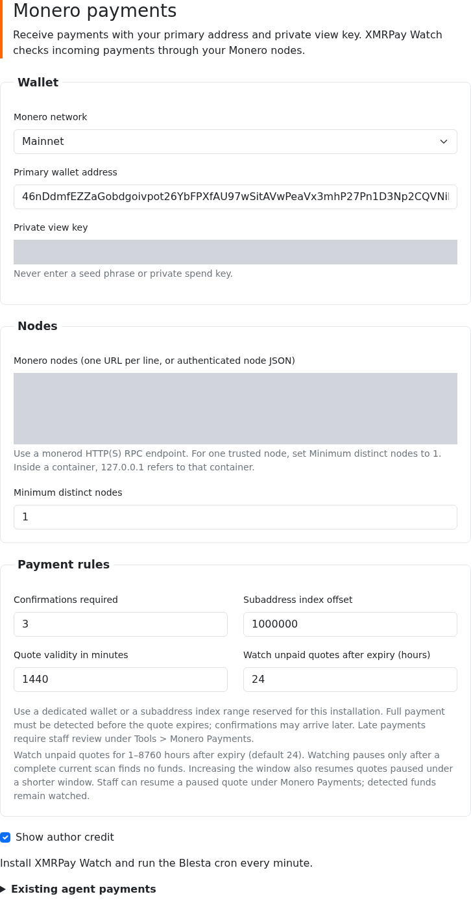
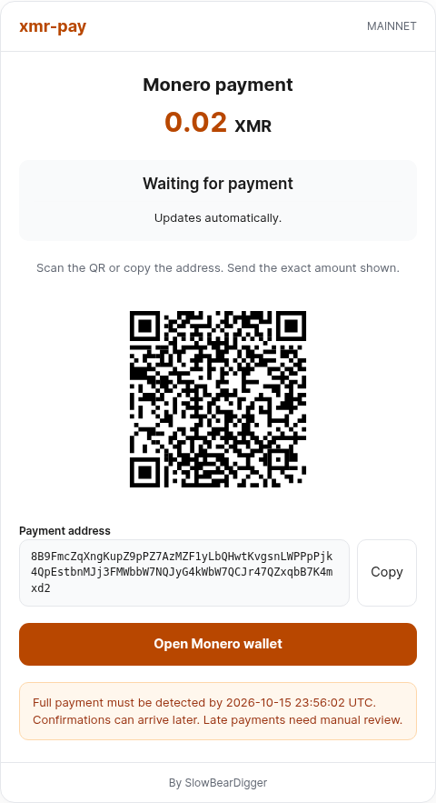
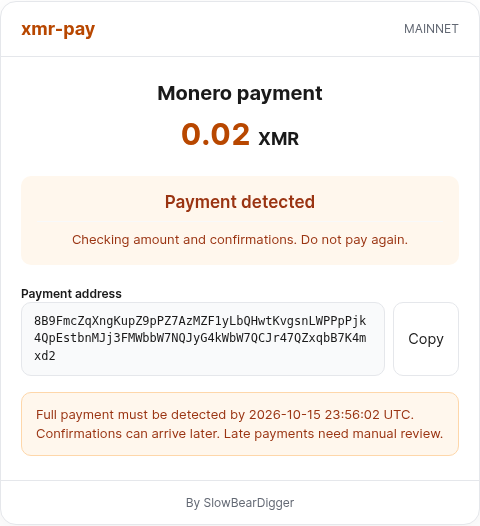
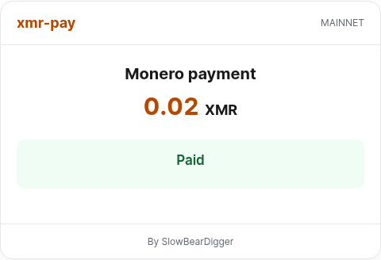

# XMRPay for Blesta 6

Accept Monero invoice payments using your primary wallet address and private view
key. XMRPay runs inside Blesta's PHP process and uses Blesta cron to check Monero
nodes. It does not need the XMRPay agent, Node.js, a wallet file or wallet RPC.

The package contains the **XMRPay (Monero)** payment gateway and **XMRPay Watch**
plugin. Install both. The gateway creates a payment address and fixed quote;
Watch detects incoming funds and records confirmed payments through Blesta's
native accounting. The checkout updates automatically as the payment progresses.

This branch uses the classic Monero RingCT engine. Mainnet is the installation
default; Stagenet and Testnet are available for testing. Experimental CARROT/FCMP++
work is maintained separately.

## Requirements

- A licensed Blesta 6 installation, including its PHP and ionCube requirements.
- PHP extensions GMP, BCMath, cURL and PDO MySQL in both web and cron PHP.
- MariaDB or MySQL with InnoDB tables.
- A primary Monero address, its matching private view key and reachable `monerod`
  HTTP(S) endpoints on the selected network.
- Blesta's system cron running every minute.

The tested environment is stock Blesta 6.0.3, PHP 8.3.35, ionCube 15.5.1 and
MariaDB 11.4.13. PHP 8.4 installation is not qualified: Blesta's bundled date
library raised a deprecation exception in that environment. A separate MySQL
server and multiple Blesta companies have not been qualified.

The view key lets the server detect incoming payments without spending funds.
It also exposes incoming-payment information. Keep it private. Never enter a
seed phrase or private spend key. Blesta encrypts the view key and node
configuration in gateway metadata; protect its encryption key and backups.

## Install

1. Extract the built installation ZIP into your Blesta directory. It contains:

   ```text
   components/gateways/nonmerchant/xmrpay/
   plugins/xmrpay_watch/
   ```

   GitHub's automatic source archives omit the bundled engine. Build an
   installation ZIP with the commands below if you are using a source checkout.

2. Under **Settings > Company > Payment Gateways**, install **XMRPay (Monero)**.
   Under **Settings > Company > Plugins**, install **XMRPay Watch**. For an
   existing installation, copy the matching files and use Blesta's **Upgrade**
   action for both components. Copying files alone does not register Watch's
   checkout validation or migrate its scan and receipt queues.
3. Open the gateway's settings and enter the wallet, network and nodes. Enable
   USD, EUR or XMR as accepted currencies. Add XMR to Blesta's currencies first
   if needed. USD and EUR quotes use CoinGecko; XMR invoices need no price feed.
4. Configure the system cron with the command shown under **Settings > System >
   Automation**. Confirm that **XMRPay Watch** is enabled with a one-minute
   interval. The task's enabled setting does not install the system cron for you.
5. Under **Settings > System > Staff > Staff Groups**, grant the appropriate
   Monero payment permissions. Viewing requests is separate from accepting
   late payments and resuming paused requests.
6. Complete a test invoice, then check its payment transaction, remaining balance
   and service status. Configure Blesta's mail delivery and check the payment
   receipt too. Service activation follows Blesta's automation and the selected
   module; it may run after the payment scan.

Watch must remain installed, upgraded and enabled. Its checkout validation runs
before gateway selection and preserves authenticated payments, signed guest
links, partial invoice payments and account credit. Native XMRPay quotes are
refused when that validation has not run. Recheck this integration when upgrading
Blesta or using other gateways alongside it.

## Configure

| Setting | Purpose | Default |
|---|---|---|
| Monero network | Must match the wallet and every configured node. | Mainnet |
| Primary wallet address | The wallet's primary address, not a subaddress. | Required |
| Private view key | The private view key matching that primary address. | Required |
| Monero nodes | One endpoint per line, or the authenticated JSON below. | Required |
| Minimum distinct nodes | Use 1 for one trusted node; otherwise provide enough distinct endpoints. | 2 |
| Confirmations required | Confirmations required before recording payment. | 10 |
| Subaddress index offset | Start of an index range reserved for this installation. | 1,000,000 |
| Quote validity in minutes | Deadline for detecting the full payment. | 60 |
| Watch unpaid quotes after expiry (hours) | Monitor empty expired requests for 1–8760 hours before pausing them. | 24 |
| Show author credit | Display the optional author link below the checkout. | Enabled |

Use a dedicated wallet or an index range reserved for this installation. Do not
reuse that range in another payment integration. Preserve payment tables and
identifiers during migrations. Wallet, network and index changes are blocked
while native requests remain pending, including expired requests that might
still receive funds. This version has no automatic wallet-retirement operation.
Pausing a request preserves its address, history and wallet reservation.



### Own, local and authenticated nodes

A node on the same host as PHP can use `http://127.0.0.1:18081` for mainnet.
Set **Minimum distinct nodes** to **1** when using one trusted node. Every
configured endpoint must be healthy, report the selected network and agree on
the chain state. The private view key stays in PHP.

Inside a container, `127.0.0.1` refers to that container. Use the node's service
name on a shared private network, or a reachable address on the host. Checkout
and cron PHP need the same node access and CA trust.

For Basic or Digest authentication, use JSON with credentials in separate fields:

```json
[
  {
    "url": "https://node.example.com:18081",
    "auth": "digest",
    "username": "billing",
    "password": "replace-with-node-password"
  }
]
```

Use `"auth": "basic"` for a Basic-auth proxy. Authenticated plain HTTP requires
`"allow_insecure_http": true` in that node's object, including loopback. Enable
it only when unencrypted transport is intentional. HTTPS verifies certificates
and hostnames; configure PHP cURL's CA trust for a private certificate authority.

## Customer checkout

Each checkout keeps its quote, address and invoice allocations. Reopening an
active request reuses them. The QR is generated locally with Blesta's bundled
library. Copying reports success only when the browser actually copies the
address; a denied clipboard operation offers manual selection.

The page checks the saved payment state automatically while it is open. These
requests only read the current checkout's status. Blockchain scanning and
settlement remain in cron, so detection can take a few minutes.

| Checkout state | Meaning |
|---|---|
| Waiting for payment | No incoming funds have been detected yet. |
| Payment detected | Incoming funds were found; the amount and confirmations still need verification. This is not a completed payment. |
| Paid | Blesta has recorded the confirmed payment. Sending controls are hidden. |
| Payment needs review | The quote expired or needs staff review. Contact support before sending more funds. |

Temporary connection failures show a reconnecting message. An unavailable payment
session asks the customer to return to their invoice. Without JavaScript, the
address, amount, QR and wallet link remain usable; the customer checks the invoice
for its status.

If a new quote cannot be created, checkout shows an error with a retry link.
Existing active quotes keep their original rate when the price feed is unavailable.

The checkout includes a **By SlowBearDigger** link to `https://xmrpay.shop`.
Turn off **Show author credit** in the gateway settings to hide it.



<details>
<summary>Detected and completed payment</summary>





</details>

Screenshots show desktop views of isolated test installations. The detected and
paid examples use valueless local-chain payments; the displayed network encoding
does not imply a transfer of real mainnet funds. Private settings are masked.

## Expiry, late payments and credit

The full payment must be detected before the quote expires to settle
automatically. Confirmations may arrive later. Sending before the deadline alone
is not sufficient if the scanner is behind. Payments first detected or completed
after expiry stay pending for staff review, even if mined before the deadline.

Use **Tools > Monero Payments** to inspect requests, received amounts, expiry and
last scan. An authorized staff member can accept a fully funded late payment at
its original quote by entering a review reason. Acceptance checks node health
and performs a fresh complete scan. Underpayments, insufficient confirmations,
changed wallets, cancelled invoices and outputs already claimed elsewhere remain
blocked. The request retains the accepting staff member, UTC time and reason.

Use that action to reconcile late XMRPay payments. Blesta's separate **Record
Payment** form does not reserve Monero outputs or close the XMRPay request.

Empty expired requests remain watched for the configured period after expiry.
The default is 24 hours, including after an upgrade without a saved setting.
Pausing requires a complete current scan started after that period has elapsed;
an incomplete scan or unavailable node cannot retire a request. Requests with
detected funds remain watched. Empty requests for voided invoices follow the
same expiry-based period; pausing or resuming them does not make those invoices
eligible for payment.

Use the **Watching paused** filter under **Tools > Monero Payments** to find
paused requests. **Resume watching** requires the late-payment permission and
a reason, records the staff member and time, and starts another monitoring
period from resumption. It preserves the original quote and expiry, so a late
payment still needs acceptance. Increasing the configured period also resumes
requests paused under a shorter period. Reducing it applies at the next complete
scan of an active request.

Blesta stores currency amounts to four decimal places; Monero detection uses exact
atomic amounts. Confirmed excess becomes proportional account credit, rounded
down to Blesta's precision. Payment state, output reservations, transaction
creation and invoice application commit together. Repeating a settled request
does not create another transaction.

If another payment reduces an invoice balance, the old checkout stops offering
instructions and asks the client to start from their invoices again. Funds fully
observed before expiry still settle; excess becomes credit.

## Payment receipts

Blesta provides the email template, contact preferences and mail transport.
Configure **Settings > Company > Emails > Mail Settings** and enable the
**Payment Received (Non-Merchant)** template. Receipts use the recorded payment's
amount and currency and go to billing contacts, or the primary contact when
there are no billing contacts. Blesta records delivery attempts in its email log.

XMRPay saves the receipt request in the same transaction as the payment, then
sends it after that transaction commits. A mail failure leaves the payment paid;
Watch retries delivery on later cron runs, including when nodes are unavailable.
Ordinary retries skip recipients already sent the receipt. An upgrade does not
send receipts for historical payments, and an inactive template suppresses them.

A process crash after SMTP accepts a message but before delivery progress is
saved can repeat that email. It does not repeat the payment or invoice credit.

## Operation and tested scope

Watch scans up to 25 requests per scheduled run, sharing a 20-second scan budget.
Database waits and accounting can extend total runtime. Progress is persisted
between runs, and requests rotate so later entries receive scan time. Expired
requests remain watched until the configured period ends and a complete scan
confirms that no funds were received. Funded requests remain in the scan queue.

Receipt delivery follows scanning, with a separate five-second budget and up to
ten due receipts per gateway. Failed or incomplete attempts wait at least one
minute before retrying. SMTP calls can extend that budget.

Completed scans resume after their verified checkpoint. The scanner checks that
checkpoint before and after reading new blocks, avoiding repeated work while
still detecting a changed chain. Requests from the same wallet with compatible
checkpoints and partial progress share block reads and output detection. Each
request retains its own scan state, expiry and payment accounting. New or resumed
requests with different progress use a separate scan group.

Monitor the pending queue, last-scan times and cron logs. Keep scan delays below
quote validity. The limit of 25 requests is not a throughput guarantee: measure
the expected active queue and block load on the intended deployment. Choose a
monitoring period that covers the expected support window without accumulating
unnecessary empty requests.

The tested flows include stock HTTPS checkout, interactive USD/EUR orders with
live CoinGecko quotes, signed guest payment links, malformed-input rejection,
native settings and upgrades, a real stagenet payment, invoice closure and
None-module activation. Payment receipts reached a local SMTP mailbox with the
correct currency and reference. A mail outage and concurrent retries preserved
one payment and one receipt per recipient. Local offline tests simulate node
health metadata; their blocks and transactions are real.

Browser checks cover Chromium at desktop and mobile widths, QR decoding, copying,
automatic payment updates and JavaScript-off behavior. A price-feed outage shows
a usable error and retry link while preserving existing quotes.

Stock database tests interrupted payment accounting before and after commit,
then restored a backup and retried. Payment, output claims and receipt intent
remained atomic, and recovery preserved one credit per payment. Authorized late
acceptance, underpayment rejection and native staff permissions were also tested.

Monitoring tests covered configuration changes, incomplete scans, detected funds,
voided invoices and staff resumption. A real late payment after resumption closed
the invoice, activated its None service and sent one receipt. Concurrent checkout
and settlement preserved one request and payment, including when checkout waited
for the payment transaction to commit.

Finite HTTPS tests used stock Blesta 6.0.3, PHP 8.3.35, Apache prefork and MariaDB
11.4 on a shared Ryzen 5 5500U host. One campaign created 1,000 requests for 100
distinct clients at concurrency 25, with p95 4.66 seconds. The last 100 remained
close to the middle 800. All requests had unique addresses and correct owners;
reopening them preserved their quotes. Another 2,000 status reads at concurrency
100 passed without database writes or node calls. Sampled Apache/MariaDB memory
peaked at 911 MiB. No request errors, timeouts or duplicate quotes occurred.

The 1.1.6 runtime was compared with the earlier candidate on identical copies
of that 1,000-order history, with the same warmup:

| HTTPS workload | Concurrency | Earlier p95 | Final p95 |
|---|---:|---:|---:|
| Create 100 additional requests | 25 | 4.83 s | 4.53 s |
| Reopen 100 requests | 100 | 17.52 s | 16.07 s |

These timings cover the native payment-page GET, form POST and confirmation GET.
They exclude login, static assets and browser rendering. Watch was idle and nodes
were local. Capacity tests used XMR invoices; new USD/EUR quotes call CoinGecko
and were not load-tested in bursts. One hundred simultaneous checkouts still
caused considerable waiting; the results are finite measurements, not a hosting
capacity guarantee. Earlier
cohorts through 50 clients also passed. Eight sessions using equivalent invoice
IDs and decimal amounts produced one quote, including across native payment and
order-checkout routes.

A separate 1.1.7 offline-chain campaign delivered three blocks of 128 real
transactions at two-minute intervals, with seven Watch runs at one-minute
intervals. Each cohort started at the same verified height; the funded control
was last in the queue and required three confirmations. The shared wallet
scanner produced these results:

| Active requests | Current after seven runs | Extra recovery runs |
|---:|---|---:|
| 10 | Yes; control paid | 0 |
| 25 | Yes; control paid | 0 |
| 50 | Yes; control paid | 0 |
| 100 | No; all requests behind by up to two blocks | 5 |

At 10 requests, active Watch time fell from 233.12 seconds in 1.1.6, including
five recovery runs, to 28.34 seconds with no recovery. At 50, it used 66.54 seconds
across the seven scheduled runs. The 100-request queue recovered in 96.50 seconds
using back-to-back extra turns; that is not normal one-minute cron latency.
During that recovery, 99 checkout reopenings and 101 status reads overlapped
Watch with no errors. Their combined p95 was 19.05 seconds at concurrency 100.
The payment, output claim and captured receipt remained unique after replay.

A separate native payment test sent two invoice payments in one transaction and
interrupted Watch between their accounting commits. Retrying closed both invoices,
activated both None services and delivered one receipt each, without duplicate
credits or output claims.

These finite tests establish neither sustained capacity for 100 active requests
under that block load nor capacity with public-node latency. Measure the active
queue and expected block load on the intended host.

External provisioning modules, external mail delivery, multiple companies, a
separate MySQL server, other browsers and physical wallet-app handoff remain
unqualified. Provisioning was verified with Blesta's None module. Fresh payment
tests use stagenet and an offline chain. These results apply to the tested
environment and flows.

## Upgrading an agent installation

The legacy loopback agent configuration and signed callbacks remain for
outstanding agent payments. Keep the agent and its secrets until those payments
are reconciled. Native wallet settings select the PHP checkout; preserve legacy
credentials if old callbacks still need verification. The systemd example in
`deploy/` applies to legacy installations only.

## Build the installation ZIP

Generated dependencies stay outside Git. The ZIP includes the required engine
and adapter files, upstream license notices, pinned revisions and a SHA-256
manifest. No Composer install or package download is needed at runtime.

Use Bash, Git, GNU coreutils, tar and zip, with clean local checkouts at:

- [xmr-pay-php](https://github.com/SlowBearDigger/xmr-pay-php): `20e330319a25cd0396a3e9b6888ded66b1ed17c5`.
- [xmr-pay-adapter-core](https://github.com/SlowBearDigger/xmr-pay-adapter-core): `c7a13fda5d35780f319b524d4d919a74124ccd2e`.

```bash
bash tools/bundle-engine.sh /path/to/xmr-pay-php /path/to/xmr-pay-adapter-core
bash tools/package.sh /existing/output/directory/xmrpay-blesta.zip
```

The bundler verifies revisions and the packager excludes untracked files.
Preserve the included license notices when redistributing the package.
